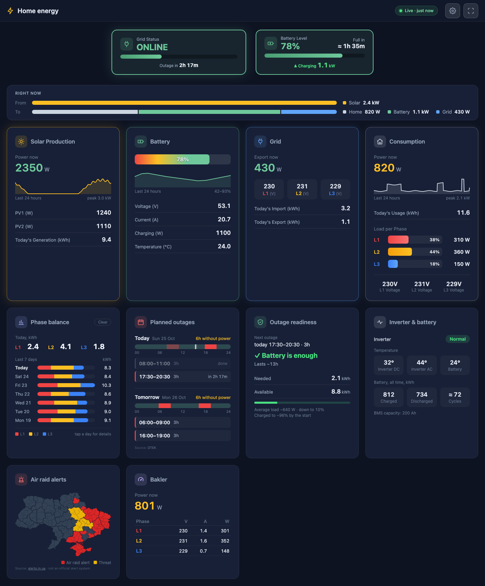
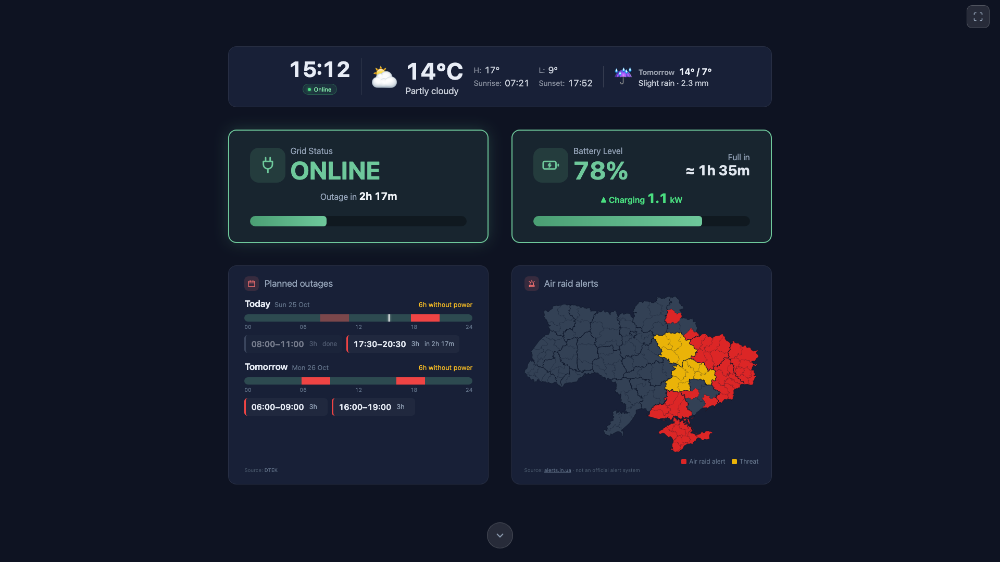

# Extended Dashboard

A web dashboard for monitoring Deye solar inverters in real-time. Supports both single-phase (e.g. SUN-6K-SG03LP1) and 3-phase hybrid models. Displays solar production, battery status, grid power, home consumption, weather conditions, and power outage schedules.

Maintained by [Cutteroid](https://github.com/cutteroid). Originally based on [deye-dashboard](https://github.com/ivanursul/deye-dashboard) by Ivan Ursul (MIT license, see [License](#license)).

> **Made for a dashboard screen.** This project is meant to run on a tablet or another always-on screen mounted on the wall, as a home energy display: a fullscreen kiosk view with large banners, low power mode, and an automatic return to the first screen. It works in any browser on your home network, but it is **not** designed as a phone app or as a public web service. Keep it on your local network (the settings PIN is basic protection, not real authentication). Tested on a 7" Samsung tablet (960×600) and on larger tablet and desktop screens.



The fullscreen kiosk view for a wall tablet:



## Changes compared to the original project

What this project adds to the original [ivanursul/deye-dashboard](https://github.com/ivanursul/deye-dashboard):

**New cards and features**
- **Air raid alerts map:** Ukraine with oblasts and raions, live from [alerts.in.ua](https://alerts.in.ua/) (with a free API token) or [NEPTUN](https://neptun.in.ua/) (no key needed), refreshed every 30 s, on a card and on the fullscreen first page. You can show the whole country or zoom to one region, with neighbouring regions dimmed around it (Settings → step 4).
- **Planned outages:** today's and tomorrow's outage windows on a timeline, plus a countdown in the grid banner. Adds a DTEK provider (Kyiv oblast, Kyiv, Dnipro, Odesa). A failed schedule fetch is no longer reported as "No outages today".
- **Bakler smart meter** (optional): live power, voltage and current per phase over MQTT, with a Mosquitto broker in `docker-compose.yml`. Phases cut by the meter or without supply are highlighted. The relay state is shown read-only. A demo mode is included.
- **Battery estimates:**
  - "Lasts about …" during an outage, counting down to the inverter's shutdown level;
  - "Full in …" while charging;
  - both based on a ~10-minute average power, with an optional `BATTERY_CAPACITY_KWH`.
- **Grid status that matches reality:** taken from the inverter's grid relay. A partial outage (e.g. "L2 DOWN" / "НЕМАЄ ФАЗИ L2") and "grid out of range" are shown separately from a total outage. Grid voltage is shown per phase.
- **Weather:** tomorrow's forecast in the fullscreen weather banner.
- **Phase balance card** (was "Daily Phase Analytics"): today's kWh per phase plus one bar per day for the last 7 days. Tap a day for details.
- **Consumption card:** home consumption and load per phase merged into one card.

**Inverter support and accuracy**
- **Inverter driver system** (`inverters/`). Deye / Sunsynk via a Solarman logger is the first driver; other brands can be added (`INVERTER_TYPE`). The UI no longer names a brand.
- **Model detection** from the inverter's device type: single-phase, 3-phase low-voltage and 3-phase high-voltage hybrids (with HV scaling handled), plus a warning for unsupported string or micro inverters. The phase count can be set in the setup wizard.
- **Fixed 3-phase readings:**
  - battery power and current (was reading the battery temperature);
  - PV power and today's PV (were reading the battery's daily counters);
  - grid voltage L2/L3.

**Interface**
- **Languages:** English, Ukrainian and Russian, chosen in the settings panel.
- **Fullscreen kiosk view:** reworked, including a compact layout for 7" tablets (960×600) and emoji that also render on old Android. A clock in the weather banner, and the view scrolls back to the first screen 30 s after the last touch (can be switched off).
- **Settings:** server settings are protected by a PIN, while local settings (language, low power mode, back to the first screen) stay open.
- **Less clutter:**
  - removed: sound alerts, the temperature block, the weather background and effects, and the moving card icons;
  - the planned outages and alerts maps no longer have their own timestamps.
- **Robust against brief failures:** a dropped request or a busy logger keeps the last data on screen. Errors are only shown when data is really unavailable, and always with the real cause.

**Running it**
- **Docker:**
  - runs on waitress;
  - config and all data files live in the `data/` volume, so they survive rebuilds and deploys;
  - `docker compose up` also starts the MQTT broker.
- **Update checker removed:** the built-in OTA updater looked for releases of the original project. On a first deploy to a plain server, `deploy.sh` even replaced the copied files with the original's latest release. Updates now go through `git pull` + Docker / `deploy_nas.sh` / `deploy.sh`.
- **Synology NAS** (e.g. DS223j):
  - `tools/export_images.sh` builds a ready-to-load image bundle;
  - `tools/deploy_nas.sh` pushes updates in seconds (one password prompt, build progress).
- **Isolated IoT network:** firewall rules for reaching the logger and the meter on a separate IoT network (see [Devices on a Separate IoT Network](#devices-on-a-separate-iot-network)).
- **Under the hood:**
  - CSS, JS and HTML split into their own files;
  - crash-safe data files;
  - validated settings;
  - background services that only start in `main()`;
  - a test suite of over 400 tests.


## How It Works (for non-technical users)

This project is a **home energy dashboard** — a web page that shows you what your solar panels are producing, how much battery you have left, whether you're using grid power, and when the next power outage is scheduled.

It is made to be shown on a **tablet on the wall** (or another screen that's always on), like a smart home display. You can also open it on a phone or computer at home to take a quick look.

### What you need

1. **A Deye solar inverter** with a Solarman Wi-Fi logger stick (the small antenna plugged into your inverter). Most Deye hybrid inverters come with one.

2. **A small home computer** that runs 24/7 on your local network. The best option is a **Raspberry Pi Zero 2W** (~$15) or any Raspberry Pi model. It uses very little power and sits quietly on your network. Any Linux computer (old laptop, mini PC, etc.) works too.

3. **Your home Wi-Fi network** — both the inverter's logger stick and the Raspberry Pi must be connected to the same network.

### How it works

```
Solar Panels → Deye Inverter → Wi-Fi Logger Stick
                                       ↓
                              Your Home Network
                                       ↓
                              Raspberry Pi (runs this dashboard)
                                       ↓
                              Your Phone / Tablet / PC (opens the dashboard in a browser)
```

The Raspberry Pi reads data from your inverter every 30 seconds over your local network. It then shows this data on a web page you can open from any device in your home — phone, tablet, or computer — by going to the Raspberry Pi's address in a browser (e.g. `http://192.168.1.50:8080`).

### Setup overview

1. **Get a Raspberry Pi** and install Raspberry Pi OS on it (many YouTube tutorials available)
2. **Connect it to your Wi-Fi** and make sure it has a fixed IP address
3. **Run the deploy script** from your computer — it copies everything to the Pi and starts the dashboard automatically
4. **Open the dashboard** in your browser — on first launch, a setup wizard will guide you through connecting to your inverter

You don't need to be a programmer, but you should be comfortable with basic computer tasks like connecting to Wi-Fi and following step-by-step instructions. If you have a tech-savvy friend or family member, ask them to help with the initial setup — after that, the dashboard runs on its own.

---

## Як це працює (для нетехнічних користувачів)

Цей проект — це **домашня енергетична панель** — веб-сторінка, яка показує, скільки електроенергії виробляють ваші сонячні панелі, який заряд акумулятора, чи використовуєте ви електрику з мережі, та коли заплановане наступне відключення.

Вона створена для **планшета на стіні** (або іншого екрана, що постійно увімкнений), як дисплей розумного будинку. Відкрити її можна й на телефоні чи комп'ютері вдома, щоб швидко глянути.

### Що вам потрібно

1. **Сонячний інвертор Deye** з Wi-Fi логером Solarman (маленька антена, підключена до інвертора). Більшість гібридних інверторів Deye комплектуються таким.

2. **Невеликий домашній комп'ютер**, який працює постійно у вашій локальній мережі. Найкращий варіант — **Raspberry Pi Zero 2W** (~$15) або будь-яка модель Raspberry Pi. Він споживає дуже мало енергії та тихо працює у вашій мережі. Будь-який Linux-комп'ютер (старий ноутбук, міні-ПК тощо) також підійде.

3. **Ваша домашня Wi-Fi мережа** — і логер інвертора, і Raspberry Pi мають бути підключені до однієї мережі.

### Як це працює

```
Сонячні панелі → Інвертор Deye → Wi-Fi логер
                                       ↓
                              Ваша домашня мережа
                                       ↓
                              Raspberry Pi (запускає цю панель)
                                       ↓
                              Ваш телефон / планшет / ПК (відкриває панель у браузері)
```

Raspberry Pi зчитує дані з вашого інвертора кожні 60 секунд через локальну мережу. Потім він відображає ці дані на веб-сторінці, яку можна відкрити з будь-якого пристрою у вашому домі — телефону, планшета чи комп'ютера — перейшовши за адресою Raspberry Pi у браузері (наприклад, `http://192.168.1.50:8080`).

### Огляд налаштування

1. **Придбайте Raspberry Pi** та встановіть на нього Raspberry Pi OS (багато відеоінструкцій на YouTube)
2. **Підключіть його до Wi-Fi** та переконайтесь, що він має фіксовану IP-адресу
3. **Запустіть скрипт розгортання** з вашого комп'ютера — він скопіює все на Pi та автоматично запустить панель
4. **Відкрийте панель** у браузері — при першому запуску майстер налаштування допоможе вам підключитися до інвертора

Вам не потрібно бути програмістом, але ви повинні вміти виконувати базові завдання на комп'ютері, такі як підключення до Wi-Fi та слідування покроковим інструкціям. Якщо у вас є технічно обізнаний друг чи родич, попросіть їх допомогти з початковим налаштуванням — після цього панель працює самостійно.

---

## Features

- **Real-time monitoring** — solar production, battery SOC, grid power, and load consumption
- **Load analytics** — per-phase power distribution with daily statistics (3-phase systems)
- **Weather** — current conditions and forecast via Open-Meteo API
- **Planned outages** — today's and tomorrow's outage windows on a timeline, plus a countdown in the grid banner (Lvivoblenergo, Yasno, or DTEK providers)
- **Outage readiness** — whether the battery will last through the next planned outage, at the last 30 minutes' average load
- **Inverter & battery health** — inverter state and temperatures, fault / warning codes, lifetime battery charge and discharge with equivalent full cycles (3-phase hybrids)
- **Air raid alerts** — map of Ukraine's regions and districts with live alert statuses (alerts.in.ua or NEPTUN)
- **Smart meter** — power, voltage, current and energy from a Bakler Wi-Fi electricity meter over MQTT (optional)
- **Grid outage detection** — browser notifications when power goes out
- **Telegram bot** — battery reports, inverter status, and Ukrainian weather poems
- **Fullscreen mode** — kiosk-friendly display with weather, grid, and battery banners
- **Responsive design** — works on desktop and mobile

## Requirements

- Python 3.7+
- Deye inverter with Solarman Wi-Fi logger
- Network access to the inverter

## Quick Start

```bash
git clone https://github.com/cutteroid/inverter-dashboard.git
cd inverter-dashboard
python3 -m venv venv
source venv/bin/activate
pip install -r requirements.txt
```

Create a `.env` file from the example and fill in your values:

```bash
cp .env.example .env
# Edit .env with your inverter IP, logger serial, etc.
```

Run the dashboard:

```bash
python app.py
```

Open http://localhost:8080 in your browser. The app is served by [waitress](https://docs.pylonsproject.org/projects/waitress/) (a production WSGI server). For local development with the Flask debugger, run `DASHBOARD_DEV=1 python app.py` — never on a device reachable from the network.

Inverter capabilities (phases, battery, PV strings, generator) are auto-detected in the background after startup. The inverter's device type (register 0) tells its family: Deye single-phase hybrid, three-phase low-voltage hybrid and three-phase high-voltage hybrid inverters are supported (HV models scale some values differently, handled automatically); string and micro inverters use other register maps and get a warning on the dashboard. Detection results are saved to `inverter_config.json` (override the path with `INVERTER_CONFIG_FILE`); the next start uses the saved result immediately. Set `INVERTER_PHASES`, `INVERTER_HAS_BATTERY`, `INVERTER_PV_STRINGS` and `INVERTER_HAS_GENERATOR` to skip detection.

Run the tests:

```bash
pip install pytest
python -m pytest        # runs tests/ (see pytest.ini), takes a few seconds
```

## Docker

You can also run the dashboard using Docker, which is the recommended approach for production deployments.

### Using Docker Compose (Recommended)

```bash
git clone https://github.com/cutteroid/inverter-dashboard.git
cd inverter-dashboard

# Build and start the dashboard (and the MQTT broker for the smart meter)
docker compose up -d

# Open http://localhost:8080 — without a configuration the setup wizard starts
# and saves it to data/.env. Or prepare it yourself first:
#   mkdir -p data && cp .env.example data/.env   (then edit data/.env)

# View logs
docker compose logs -f

# Stop the dashboard
docker compose down
```

### Using Docker CLI

```bash
# Build the image
docker build -t inverter-dashboard:latest .

# Run the container (configuration and data live in ./data, see Data Persistence)
docker run -d \
  --name inverter-dashboard \
  -p 8080:8080 \
  -v $(pwd)/data:/app/data \
  --restart unless-stopped \
  inverter-dashboard:latest
```

Don't pass the settings with `--env-file` / `-e`: environment variables take precedence over `data/.env`, so changes saved from the dashboard's settings would be ignored.

### Install from Docker Hub (e.g. Synology Container Manager)

Each release is published as an image for Intel/AMD and ARM machines: [`cutteroid/inverter-dashboard`](https://hub.docker.com/r/cutteroid/inverter-dashboard) (tags: the version, e.g. `2.4.0`, and `latest`). No source code or build needed.

**Synology (DSM 7.2, Container Manager):**

1. **Registry:** search `cutteroid/inverter-dashboard` → **Download** → tag `latest`.
2. **File Station:** create a folder for the dashboard's data, e.g. `docker/inverter-dashboard/data`.
3. **Container → Create:** pick the image, then:
   - enable auto-restart;
   - **Port settings:** local port `8080` → container port `8080`;
   - **Volume settings:** add the folder from step 2, mounted at `/app/data`.
4. Open `http://<NAS-IP>:8080`. The setup wizard starts and saves the configuration in that folder.

The data folder needs no special permissions: at start the container makes it writable for the dashboard's user (uid 1000), changing only what that user can't write yet, then runs the dashboard as that user. **Updates:** Registry → download `latest` again, then stop and delete the container and create it again with the same settings. The data folder keeps the configuration and statistics.

The smart meter's MQTT broker isn't part of this image. For the smart meter, install with Docker Compose from the source as above (or with the bundle below).

With plain Docker: `docker run -d --name inverter-dashboard -p 8080:8080 -v /path/to/data:/app/data --restart unless-stopped cutteroid/inverter-dashboard:latest`.

### Running on Another Machine Without Building (e.g. Synology NAS)

`tools/export_images.sh` packs the dashboard and Mosquitto images with a ready-to-run `docker-compose.yml` into `dist/extended-dashboard-<arch>.tar.gz`; the target machine needs only Docker, no source code or build. Pass the target CPU: `arm64` (default on Apple Silicon; Raspberry Pi 4/5, Synology j/value models such as DS223j) or `amd64` (Intel/AMD PCs, Synology "+" models). Install steps for Synology and plain Linux are in `INSTALL.md` inside the archive. Your `data/.env` is not included (it holds secrets) — copy it over yourself if you want the same settings.

```bash
tools/export_images.sh          # this machine's architecture
tools/export_images.sh amd64    # cross-build for an Intel/AMD machine
```

**Updates:** `tools/deploy_nas.sh` sends only the files the image is built from (~0.2 MB) to the NAS over SSH and rebuilds there (`docker compose up -d --build`); Docker reuses its cached layers, so a code-only update takes seconds. The first run asks for the SSH login and the dashboard folder on the NAS (saved to `tools/.deploy_nas.env`, not committed) and is slow once, because the NAS downloads the Python base image and installs the packages. `data/` on the NAS is never touched. The script asks for the NAS password once at the start of each run and uses it for both the SSH login and `sudo` (on DSM they're the same; it only asks again if `sudo` rejects it). With an SSH key (`ssh-copy-id user@nas`) the login needs no password, and if `sudo` needs none either, the script doesn't ask at all. `tools/deploy_nas.sh --setup` changes the saved address.

### Data Persistence

The container mounts a `data` volume at `/app/data`. Everything the dashboard stores lives there, so it survives rebuilds and deploys:
- Configuration (`.env`)
- Phase statistics (`phase_stats.json`)
- Grid import log, generator log, last inverter readings, detected inverter model (`grid_daily_log.json`, `generator_log.json`, `inverter_cache.json`, `inverter_config.json`)
- Telegram bot state and battery reports (`bot_state.json`, `battery_reports/`)
- Smart meter daily counter (`smart_meter_daily.json`), its outage log (`meter_outages.json`) and Mosquitto broker files (`mosquitto/`)

Without a `data` folder (plain installs) the files are kept next to the app, as before. Each path can be overridden with its `*_FILE` variable.

### Health Checks

The container includes a built-in health check that pings the `/api/data` endpoint every 30 seconds. Check the health status with:

```bash
docker ps  # Shows health status
docker inspect inverter-dashboard --format='{{.State.Health.Status}}'
```

For detailed Docker configuration options, troubleshooting, and production deployment tips, see [DOCKER.md](DOCKER.md).

## Configuration

All configuration is done via environment variables, typically set in a `.env` file. See `.env.example` for a complete template.

### Inverter (required)

The dashboard reads the inverter through a driver (`inverters/`). Supported so far: **Deye / Sunsynk hybrid inverters with a Solarman Wi-Fi logger** (driver `deye`, the default). Other brands can be added as drivers; see `inverters/__init__.py`.

| Variable | Description | Example |
|----------|-------------|---------|
| `INVERTER_TYPE` | Inverter driver | `deye` (default) |
| `INVERTER_IP` | IP address of the inverter's logger on the local network | `192.168.1.100` |
| `LOGGER_SERIAL` | Serial number of the Solarman Wi-Fi logger (printed on the stick or found in the Solarman app) | `1234567890` |

### Inverter Capabilities (optional)

These are auto-detected at startup. Set them only if auto-detection doesn't work for your model.

| Variable | Description | Default |
|----------|-------------|---------|
| `INVERTER_PHASES` | Number of phases (`1` or `3`); also in Settings → Edit configuration (step 1) | auto-detected |
| `INVERTER_HAS_BATTERY` | Whether a battery is connected (`true` / `false`) | auto-detected |
| `INVERTER_PV_STRINGS` | Number of PV strings (`1` or `2`) | auto-detected |
| `BATTERY_CAPACITY_KWH` | Battery capacity for the battery banner's time estimates — "Lasts about" during outages, "Full in" while charging — if the inverter's own value is wrong. Without it: battery capacity in Ah from the inverter (BMS-measured, else the inverter setting) × the battery's nominal voltage (51.2 V for 48 V LiFePO4; high-voltage stacks: the live voltage); the estimates use the average charge / discharge power of the last ~10 minutes and count down to 100% / the inverter's shutdown SOC | from the inverter |

### Weather

| Variable | Description | Default |
|----------|-------------|---------|
| `WEATHER_LATITUDE` | Latitude for weather forecast | `50.4501` |
| `WEATHER_LONGITUDE` | Longitude for weather forecast | `30.5234` |

Coordinates are used to fetch weather data from the [Open-Meteo API](https://open-meteo.com/). Find your coordinates on [latlong.net](https://www.latlong.net/).

### Outage Schedule

| Variable | Description | Default |
|----------|-------------|---------|
| `OUTAGE_PROVIDER` | Provider name: `lvivoblenergo`, `yasno`, `dtek`, or `none` | `none` |
| `OUTAGE_GROUP` | Your outage queue/group number (e.g. `1.1`, `2.2`) | — |

**Yasno-specific settings** (only when `OUTAGE_PROVIDER=yasno`):

| Variable | Description | Default |
|----------|-------------|---------|
| `OUTAGE_REGION_ID` | Yasno region ID (e.g. `25` for Kyiv) | — |
| `OUTAGE_DSO_ID` | Yasno DSO ID (e.g. `902` for DTEK Kyiv) | — |

**DTEK-specific settings** (only when `OUTAGE_PROVIDER=dtek`):

DTEK has no public API, so this provider reads the community feed [outage-data-ua](https://github.com/Baskerville42/outage-data-ua), which mirrors DTEK's published schedules every few minutes. Only definite outages are shown; "possible outage" hours are ignored.

| Variable | Description | Default |
|----------|-------------|---------|
| `OUTAGE_DTEK_REGION` | `kyiv-region` (Kyiv oblast), `kyiv`, `dnipro`, or `odesa` | `kyiv-region` |

### Dashboard Name

The app bar at the top shows the dashboard's name, the live status ("● Live · 12 s ago": green while the readings are fresh, amber "Updated 3 min ago" when they're older, red when the dashboard can't be reached) and the settings and fullscreen buttons. By default the name is "Home energy" in the dashboard's language; set your own in Settings → Edit configuration → step 5.

| Variable | Description | Default |
|----------|-------------|---------|
| `DASHBOARD_TITLE` | Name at the top of the page and in the browser tab (up to 40 characters, no `#`, quotes or `\`) | "Home energy", translated |

### Settings PIN

The settings panel (gear button) opens without a PIN for local, per-device settings: language, low power mode and back to the first screen. Server-side settings — Edit Configuration and Factory Reset — are locked behind the settings PIN (**Unlock** in the panel) and lock again when the panel closes. The server enforces the same PIN on the API endpoints behind them: config read/save/reset, inverter discovery and clearing phase statistics. After 5 wrong attempts, PIN checks are locked for 60 seconds.

| Variable | Description | Default |
|----------|-------------|---------|
| `SETTINGS_PIN` | PIN for the settings panel | `0000` |

This is basic protection for a kiosk display, not real authentication: the PIN is sent in plain HTTP. Factory Reset deletes `.env`, which resets the PIN to `0000`. During first-run setup no PIN is required.

### Air Raid Alerts

The **Air raid alerts** card shows a map of Ukraine's regions and districts (raions) coloured by status: red — air raid alert, yellow — threat (yellow level, e.g. drones). Alerts can cover a whole region or single districts. In fullscreen mode the map sits next to Planned outages on the first screen.

Two data sources; the server polls the chosen one every 30 seconds and the card shows a "Source: …" link and a note that it is not an official alert system:

- **[alerts.in.ua](https://alerts.in.ua/)** ([API docs](https://devs.alerts.in.ua/)), recommended. Needs a personal API token (request it on the API docs page). One request returns the status of every oblast, raion and hromada by its stable location ID, so matching never depends on names; a raion with alerts in only some of its hromadas shows as partial. The token stays on the server: it is sent in a request header, never in URLs, logs or the page, and the configuration editor only shows it masked. The API answers only requests from Ukraine, allows 8–10 requests per minute (the dashboard makes 2) and supports `If-Modified-Since`.
- **[NEPTUN](https://neptun.in.ua/)** ([developer docs](https://neptun.in.ua/developers)): free, no key needed. The server requests `GET https://neptun.in.ua/api/v1/alerts` (their terms allow at most one request per 5 seconds) with `If-None-Match`. NEPTUN reports oblasts and raions by name, matched to the map by Ukrainian name. Its [terms of use](https://neptun.in.ua/api-terms) require the visible source link and the "not an official alert system" note.

| Variable | Description | Default |
|----------|-------------|---------|
| `AIR_ALERTS_PROVIDER` | `alerts_in_ua`, `neptun`, `mock` (demo data, marked "Demo data") or `none` to hide the card | `alerts_in_ua` with a token, else `neptun` |
| `ALERTS_IN_UA_TOKEN` | alerts.in.ua API token (kept on the server) | — |
| `AIR_ALERTS_REGION` | Zoom the map to one region, with the neighbouring regions dimmed around it (ISO 3166-2 code, e.g. `UA-32` Kyiv oblast — includes Kyiv city; `UA-43` Crimea includes Sevastopol) | whole Ukraine |

All three are also in Settings → Edit configuration, step 4 ("Air raid alerts": on/off, data source with its token, and which region the map shows).

**Map data:** `static/data/ukraine-regions.json` is generated by `tools/build_ukraine_map.py` from the OCHA Common Operational Dataset *Ukraine – Subnational Administrative Boundaries* (State Scientific Production Enterprise "Kartographia"), licensed [CC BY-IGO](https://creativecommons.org/licenses/by/3.0/igo/), source: [data.humdata.org/dataset/cod-ab-ukr](https://data.humdata.org/dataset/cod-ab-ukr). The script also stores each region's and district's alerts.in.ua location ID, from their public location list (its CSV export is the script's second argument). NEPTUN alerts are matched by Ukrainian region/district name instead (with aliases for raions NEPTUN still lists under their pre-2024 names).

### Smart Meter (optional)

The **Smart meter** card shows live readings from a [Bakler](https://www.bakler.com.ua/) Wi-Fi electricity meter: current power, voltage and current (a per-phase table for three-phase meters, where a phase below 100 V is shown as "No voltage"), mains frequency and the relay state. When the meter or the broker is unavailable, a badge says so (Waiting for data / Meter offline / No recent data / MQTT broker unavailable) and the last known readings are dimmed. The relay is shown only; the dashboard never switches it.

With the meter, an **Outage history** card lists the grid outages it saw today and yesterday, newest first, with start, end and duration (a running one counts on). **No grid**: every phase without voltage, or the meter went offline (it's powered by the grid) for 90 s while the inverter doesn't see the grid either; if the inverter still has the grid, the meter only lost its Wi-Fi and nothing is logged. **Partial**: some phases missing, each marked as *no voltage from the grid* or *disconnected by the meter* (its relay, e.g. the overvoltage protection; three-phase meters with one relay per phase). The meter's wait before it switches the house back on after an outage (its switch-on delay, a setting in the meter's app) counts as part of that outage; a longer hold is its protection and an entry of its own. The meter doesn't report that setting, so if yours isn't the default 120 s, set `SMART_METER_SWITCH_ON_DELAY` (seconds) in `data/.env`. The card shows the latest five, with today's count and time without power; the rest of today and yesterday is one tap away. Outages under 10 s aren't kept; older days are dropped. Kept in `data/meter_outages.json`.

The meter talks MQTT: it connects to a broker and publishes its readings there ([MQTT docs, in Ukrainian](https://www.bakler.com.ua/setting-mqtt-client/)). `docker compose` starts a Mosquitto broker (`inverter-mosquitto`, port 1883) next to the dashboard.

1. Add to `data/.env` (choose your own user name and password):
   ```
   SMART_METER_ENABLED=true
   SMART_METER_MQTT_USER=meter
   SMART_METER_MQTT_PASSWORD=choose-a-long-password
   ```
2. `docker compose up -d` (restarts the broker and the dashboard with the new settings).
3. In the meter's app open **Settings → Integration → MQTT** and enter: broker = IP address of the dashboard machine on your network, port `1883`, the same user name and password.

The card appears with "Waiting for data" and fills in after the meter's first message. The dashboard asks the meter to send readings every `SMART_METER_INTERVAL` seconds; the full summary (frequency, relay) arrives once a minute.

Without `SMART_METER_MQTT_USER` / `SMART_METER_MQTT_PASSWORD` the broker accepts no connections from the network, so it is never open without a password. If the meter (or the inverter's logger) is on a separate IoT / guest network, see [Devices on a Separate IoT Network](#devices-on-a-separate-iot-network).

| Variable | Description | Default |
|----------|-------------|---------|
| `SMART_METER_ENABLED` | Show the card and connect to the broker | `false` |
| `SMART_METER_MQTT_USER` / `SMART_METER_MQTT_PASSWORD` | Broker login (also creates the Mosquitto user) | — |
| `SMART_METER_MQTT_HOST` | Use another broker instead of the bundled one | `mosquitto` in Docker, else `localhost` |
| `SMART_METER_MQTT_PORT` | Broker port | `1883` |
| `SMART_METER_SERIAL` | Meter serial (topic `buckler/<serial>/…`) when several meters share the broker; otherwise the first one seen is used | — |
| `SMART_METER_INTERVAL` | Update interval requested from the meter, 1–60 s (`0` = leave the meter's setting) | `10` |
| `SMART_METER_DAILY_FILE` | Where today's starting counter is kept | `data/smart_meter_daily.json` |
| `SMART_METER_DEMO` | `1` / `3`: show simulated single-/three-phase readings (marked "Demo data") instead of a real meter; no broker needed. The three-phase demo drops L3 for the first minute of every 5 minutes | — |

### Language

The dashboard UI is available in English (default), Ukrainian and Russian. Switch in the settings panel (gear button), which lists the available languages; the choice is stored in the browser's local storage, so each device keeps its own language.

Translations live in `locales/<lang>.json` (one file per language, nested keys, `{name}` placeholders). To add a language, copy `locales/en.json` to e.g. `locales/pl.json`, translate the values, and restart — the settings panel lists it automatically. `tests/test_i18n.py` checks that every locale has the same keys and placeholders as English.

The Telegram bot is Ukrainian-only and is not affected by this setting.

### Outage Readiness

The **Outage readiness** card (shown with an outage schedule and a battery) answers whether the battery will last through the next planned outage, today's or tomorrow's (back-to-back windows count as one outage):

- **Needed:** the home's average load over the last 30 minutes × the outage's length, plus 10% for the inverter's own losses.
- **Available:** the battery's charge down to the inverter's shutdown SOC. If the battery is still charging, the charge it will have when the outage starts.
- **Verdict:** "Battery is enough" (at least 20% to spare), "Just enough", or "Short by ~…" (red). During an outage it counts the rest of it.

The load during an outage can differ (a kettle, a heater), so treat it as an estimate.

### Inverter & Battery Health

The **Inverter & battery** card shows the inverter's state (Normal, Standby, Warning, Fault), its DC- and AC-side temperatures, and the battery's lifetime charged and discharged energy with the equivalent number of full cycles (total discharged ÷ capacity). While the inverter reports a warning or fault, the card turns amber or red and lists the codes (F13, W03, …) as in the inverter manual. The state is read with every poll; temperatures, totals and codes every 5 minutes, and right away while there is a problem. So far the card is available for 3-phase hybrid inverters.

### Back to the First Screen

In fullscreen mode the dashboard scrolls back to the first screen (weather, grid, battery, outages, alerts) 30 seconds after the last touch, scroll or key press, so a wall tablet isn't left showing the details. Switch it off under **Settings → Display → Back to the first screen**; like low power mode, it is stored per device.

### Low Power Mode

For always-on wall tablets, **Settings → Display → Low power mode** turns off all animations, transitions and blur effects to reduce CPU/GPU load. It is stored per device (browser local storage). Animations are also turned off automatically when the device has the system "Reduce motion" accessibility setting enabled.

### Telegram Bot (optional)

| Variable | Description | Default |
|----------|-------------|---------|
| `TELEGRAM_ENABLED` | Enable the Telegram bot (`true` / `false`) | `false` |
| `TELEGRAM_BOT_TOKEN` | Bot token from [@BotFather](https://t.me/BotFather) | — |
| `TELEGRAM_ALLOWED_USERS` | Comma-separated list of allowed Telegram user IDs | — |

**How to set up:**

1. Message [@BotFather](https://t.me/BotFather) on Telegram and create a new bot with `/newbot`
2. Copy the bot token into `TELEGRAM_BOT_TOKEN`
3. Find your Telegram user ID (see below), add it to `TELEGRAM_ALLOWED_USERS`
4. Set `TELEGRAM_ENABLED=true` and restart the dashboard

**How to find your Telegram user ID:**

There are two ways:

- **Using this bot** — set `TELEGRAM_ENABLED=true` with your bot token and leave `TELEGRAM_ALLOWED_USERS` empty for now. Start the dashboard, then open your bot in Telegram and send `/start`. The bot will reply with your numeric user ID (e.g. `123456789`). Add it to `TELEGRAM_ALLOWED_USERS` and restart.
- **Using @userinfobot** — search for `@userinfobot` in Telegram, start it, and it will immediately reply with your user ID.

For multiple users, separate IDs with commas: `TELEGRAM_ALLOWED_USERS=123456789,987654321`

**Bot commands:**

| Command | Description |
|---------|-------------|
| `/start` | Shows your Telegram user ID and authorization status |
| `/battery` | Current battery SOC, voltage, power, and estimated time remaining |
| `/outage` | Next scheduled power outage window and countdown |
| `/grid` | Daily grid consumption report (import/export) |
| `/test` | Sends sample battery and grid messages |

The bot also provides a keyboard with Ukrainian-labeled buttons for quick access. Messages include weather-themed Ukrainian poetry excerpts.

### Data Files (optional)

| Variable | Description | Default |
|----------|-------------|---------|
| `PHASE_STATS_FILE` | Path to phase statistics JSON file | `phase_stats.json` |

### Deployment (used by `deploy.sh`)

| Variable | Description | Example |
|----------|-------------|---------|
| `DEPLOY_HOST` | Remote server IP or hostname | `192.168.1.50` |
| `DEPLOY_USER` | SSH user on the remote server | `pi` |
| `DEPLOY_DIR` | Installation directory on the remote server | `/home/pi/inverter-dashboard` |
| `DEPLOY_SERVICE_NAME` | Systemd service name (installs that used the old name `deye-dashboard` keep it while it's saved in `.env`; set this to rename it, and `deploy.sh` replaces the old service) | `inverter-dashboard` |

## Local Development

Use `deploy_local.sh` to run the dashboard locally with the Telegram bot disabled:

```bash
chmod +x deploy_local.sh
./deploy_local.sh
```

This sources your `.env`, overrides `TELEGRAM_ENABLED=false`, activates the virtual environment, and starts the app. Useful for UI development without triggering bot messages.

You need a `.env` file with at least `INVERTER_IP` and `LOGGER_SERIAL` set. Either create one manually from `.env.example` or run `./deploy.sh` once to generate it interactively.

## Deploying to a Remote Server

`deploy.sh` deploys the dashboard to a remote Linux server over SSH and sets it up as a systemd service. The remote server needs Python 3.7+, SSH access, and `sudo` for systemd management.

### Prerequisites

- SSH key-based access to the remote server (the script runs `ssh` and `rsync` non-interactively)
- `sudo` privileges on the remote server (for systemd service setup)
- Python 3.7+ installed on the remote server

### First-time deploy

If no `.env` file exists, the script runs an interactive setup wizard:

```bash
chmod +x deploy.sh
./deploy.sh
```

The wizard prompts for all settings in order:

1. **Inverter** — IP address and logger serial number
2. **Deployment** — remote host, SSH user, install directory, service name
3. **Weather** — latitude and longitude for forecast (defaults to Kyiv)
4. **Outage schedule** — provider selection (Lvivoblenergo, Yasno, or none) with provider-specific follow-up questions
5. **Telegram** — enable/disable, bot token, and allowed user IDs

After answering all prompts, the script:
- Writes the `.env` file
- Prints a summary of all settings
- Asks for confirmation before deploying

If you decline, the `.env` is kept so you can edit it and re-run `./deploy.sh`.

### Subsequent deploys

When `.env` already exists, the script skips all prompts and deploys immediately:

```bash
./deploy.sh
```

To change settings, edit `.env` directly and re-deploy.

### What the deploy script does

1. **Rsync** — copies `app.py`, `inverters/`, `telegram_bot.py`, `poems.py`, `outage_providers/`, `requirements.txt`, `templates/`, and `.env` to the remote server
2. **Python setup** — creates a virtual environment (if needed) and installs dependencies from `requirements.txt`
3. **Systemd service** — creates a service file at `/etc/systemd/system/<service-name>.service`, enables it, and restarts it
4. The dashboard runs on port 8080 by default

### Managing the remote service

```bash
# Check status
ssh user@host 'sudo systemctl status inverter-dashboard'

# View live logs
ssh user@host 'sudo journalctl -u inverter-dashboard -f'

# Restart after config changes
ssh user@host 'sudo systemctl restart inverter-dashboard'

# Stop the service
ssh user@host 'sudo systemctl stop inverter-dashboard'
```

## Finding Your Inverter Details

### Inverter IP

Check your router's connected devices list or scan your network:

```bash
nmap -sP 192.168.1.0/24
```

### Logger Serial Number

The serial number is printed on the Solarman Wi-Fi logger stick, or can be found in the Solarman app under device settings.

## Devices on a Separate IoT Network

If the inverter's logger and the smart meter are on an isolated IoT / guest Wi-Fi (no access to the home network) and the dashboard runs on the home network, the router has to let exactly the dashboard's traffic through, in one direction each:

| Connection | Who connects | Port |
|------------|--------------|------|
| Dashboard → Solarman logger | the dashboard (polls the inverter) | TCP 8899 on the logger |
| Smart meter → dashboard host | the meter (it is an MQTT client of the broker) | TCP 1883 on the dashboard host |

Everything else stays blocked: the IoT devices can't open any other connection into the home network, and the dashboard host can't open connections to the meter.

On ASUS routers the IoT network ("Guest Network Pro") has only an all-or-nothing "Access Intranet" switch, so this needs [Asuswrt-Merlin](https://www.asuswrt-merlin.net/) firmware and a firewall script. Other routers usually offer the same as "allow rules" between networks / VLANs: create the rules from the table above.

1. Give the dashboard host, the logger and the meter fixed addresses (DHCP reservations), and keep "Access Intranet" **off** on the IoT network.
2. In Merlin, enable *Administration → System → Enable JFFS custom scripts and configs* and SSH.
3. Create `/jffs/scripts/firewall-start` on the router (example addresses; use your own):

   ```sh
   #!/bin/sh
   NAS=192.168.1.10         # dashboard host, home network
   LOGGER=192.168.20.30     # Solarman logger, IoT network
   METER=192.168.20.40      # Bakler smart meter, IoT network

   # Delete first, so re-running the script doesn't stack duplicate rules
   iptables -D FORWARD -s $NAS -d $LOGGER -p tcp --dport 8899 -j ACCEPT 2>/dev/null
   iptables -D FORWARD -s $LOGGER -d $NAS -p tcp --sport 8899 -m state --state ESTABLISHED -j ACCEPT 2>/dev/null
   iptables -D FORWARD -s $METER -d $NAS -p tcp --dport 1883 -j ACCEPT 2>/dev/null
   iptables -D FORWARD -s $NAS -d $METER -p tcp --sport 1883 -m state --state ESTABLISHED -j ACCEPT 2>/dev/null

   # NAS -> logger: NAS may open connections to the logger's port 8899 only;
   # the logger may only reply on those connections
   iptables -I FORWARD -s $NAS -d $LOGGER -p tcp --dport 8899 -j ACCEPT
   iptables -I FORWARD -s $LOGGER -d $NAS -p tcp --sport 8899 -m state --state ESTABLISHED -j ACCEPT

   # Meter -> NAS: the meter may connect to the MQTT broker (port 1883) only;
   # the NAS may only reply on those connections
   iptables -I FORWARD -s $METER -d $NAS -p tcp --dport 1883 -j ACCEPT
   iptables -I FORWARD -s $NAS -d $METER -p tcp --sport 1883 -m state --state ESTABLISHED -j ACCEPT
   ```

   Leave out the `METER` lines if you have no smart meter.
4. Make it executable and apply it: `chmod a+rx /jffs/scripts/firewall-start`, then `service restart_firewall` (or reboot). The router runs the script again after every firewall restart, and it survives firmware updates.
5. Use the logger's IoT address as `INVERTER_IP` (Settings → Edit configuration). Network scan can't find it from the home network, so enter it by hand. Point the meter's MQTT settings at the dashboard host's home-network address (see [Smart Meter](#smart-meter-optional)).

**Check:** from the dashboard host, `docker exec inverter-dashboard python -c "import socket; socket.create_connection(('192.168.20.30', 8899), 3); print('logger reachable')"`; for the meter, `docker logs inverter-mosquitto` shows a client connecting from its address. If the dashboard host has its own firewall (e.g. Synology: Control Panel → Security → Firewall), allow TCP 1883 from the meter there as well. If a check fails, `iptables -S FORWARD` on the router shows whether the rules are in place.

## Utility Scripts

```bash
# Test inverter connection
python test_connection.py

# Scan for battery voltage register
python scan_battery.py

# Scan for phase-related registers
python scan_phases.py

# Scan all available registers
python scan_registers.py
```

## API Endpoints

| Endpoint | Method | Description |
|----------|--------|-------------|
| `/api/data` | GET | Current inverter readings |
| `/api/weather` | GET | Current weather and forecast |
| `/api/outage_schedule` | GET | Current outage status, plus today's and (if published) tomorrow's planned windows |
| `/api/phase-stats` | GET | Daily phase statistics |
| `/api/phase-stats/clear` | POST | Clear phase statistics |

## Support

If the dashboard is useful to you, you can support its authors on donatello.to:

- [Cutteroid](https://donatello.to/Cutteroid): this project
- [Ivan Ursul](https://donatello.to/IvanUrsul): the original deye-dashboard

The "How to support the authors" link at the bottom of the dashboard's settings panel leads here.

## License

MIT License, see [LICENSE](LICENSE).

This project is originally based on [deye-dashboard](https://github.com/ivanursul/deye-dashboard) by Ivan Ursul, also released under the MIT license. His copyright notice is kept in [LICENSE](LICENSE), as the license requires; code from it still makes up part of this project.
